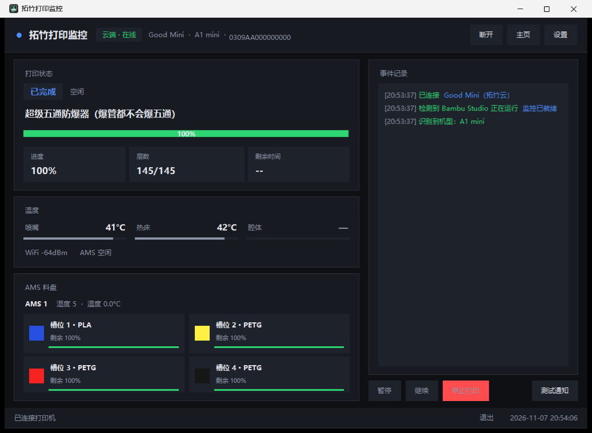
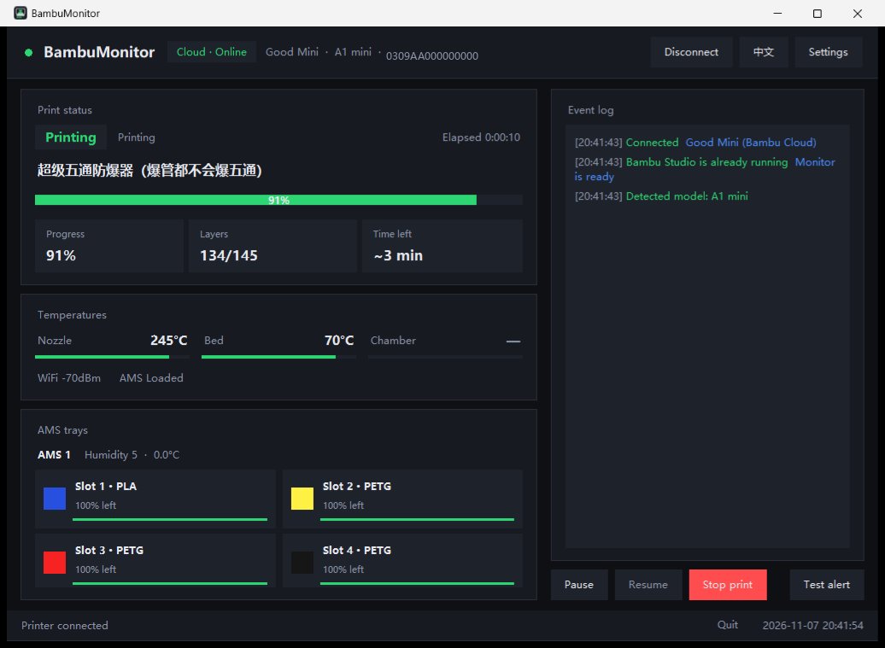

<div align="center">

# 🖨️ BambuMonitor

**Print finished, filament change, machine error — let your PC tell you, instead of you watching it.**

A small Windows tray-style monitor for [Bambu Lab](https://bambulab.com) 3D printers.<br>
Direct LAN connection, zero-config discovery, and Bambu Cloud relay for when the printer is on a different network.

[](#)
[](#)
[](#-license)
[](https://github.com/ou0826/bambu-monitor/releases)
[](https://github.com/ou0826/bambu-monitor/stargazers)

[中文说明](README.md) · [Download](https://github.com/ou0826/bambu-monitor/releases) · [Quick Start](#-quick-start) · [Feature guide](docs/FEATURES.md) · [Dev guide](docs/DEVELOPMENT.md) · [FAQ](#-faq)

</div>



---

## ✨ Why this exists

Bambu Studio is a great slicer, but it **won't tell you when a print finishes**. Bambu Handy notifications only reach your phone.

This tool fills that gap: **status comes from your LAN (or Bambu Cloud), notifications land on your Windows desktop.**

- Print finished → toast + chime, your part is ready
- Filament change / runout → tells you the **actual reason**, not just "paused"
- Machine error → HMS code, which module, and what to check
- Printer offline → nudges you to check power and Wi-Fi

And it stays out of your way: toasts go to the Action Center, and only important events pop a topmost card that auto-closes in 20 seconds — click it to open the panel.

---

## 🎯 Features

| | Feature | Notes |
|---|---|---|
| 📊 | **Live status** | Progress, layer, time left, elapsed, nozzle / bed / chamber temps, Wi-Fi signal |
| 🎨 | **AMS trays** | Colour and material per slot; remaining % is only reliable for RFID spools |
| 🔔 | **Event alerts** | Finished / failed / paused / filament change / HMS error / offline — each toggleable |
| 🔊 | **Three channels** | Windows toast (Action Center) + topmost popup + synthesised chime |
| 🏷️ | **Model detection** | A1 mini / A1 / P1P / P1S / P2S / X1 / X1 Carbon / X1E / H2D series |
| 🪟 | **Follows Bambu Studio** | Pops up and connects when you launch Bambu Studio; hides when you close it (optional) |
| 🧭 | **System tray** | Closing the window hides it to the tray; right-click to open / pause / resume / quit |
| 🌐 | **Bilingual UI** | Switch between 中文 and English in Settings (restarts automatically) |
| 🔀 | **Two transports** | Direct LAN (fastest) or Bambu Cloud relay (cross-network) |
| 🎮 | **Remote control** | Pause / resume / stop from the panel (stop asks for confirmation) |
| 🔒 | **Local first** | LAN mode never leaves your network; cloud mode stores a token, never your password |

---

## 📦 Quick Start

### 1️⃣ Download

Grab `BambuMonitor-v1.0.0.zip` from [**Releases**](https://github.com/ou0826/bambu-monitor/releases) and unzip anywhere — **no Python required**.

> Prefer running from source? See [Run from source](#-run-from-source).

### 2️⃣ Connect your printer

Launch `拓竹打印监控.exe` (the exe keeps its Chinese name) → click **设置** (Settings) in the top right:

- Click **自动搜索打印机** ("auto-discover"): scans your LAN in 1–3 s and fills in IP + serial
- Access code can be imported with **从 Bambu Studio 导入访问码**, or typed manually
  (on the printer: **Settings → Network → Access Code**, 8 characters)
- Click **测试连接** ("test connection"), then **保存** ("save")

### 3️⃣ Pick what you want to be told about

In Settings, tick the events you care about: print started / finished / failed / paused / cancelled / filament change / HMS alert / connection lost, plus the delivery channels.

Use **试听/测试通知** ("test notification") to verify instantly.

To keep it always available: tick **开机自动启动** (start at login) + **启动时最小化** (start minimised).

> [!NOTE]
> **Closing the window with X only minimises it to the taskbar — the process keeps running.**
> To actually quit, use the **退出** ("quit") link in the bottom-right corner.

---

## 🔀 Two ways to connect

| | 🏠 Direct LAN | ☁️ Bambu Cloud |
|---|---|---|
| **When** | Printer and PC on the same network | They are on different networks (e.g. printer on a phone hotspot) |
| **Requires** | The printer's **access code** | Internet + signed-in Bambu account |
| **Latency** | Lowest (printer pushes every 2 s) | One extra hop, plenty for monitoring |
| **Privacy** | Stays inside your LAN | Status transits Bambu's official servers |
| **Camera** | Direct stream possible | Not supported |
| **Recommended** | ⭐ Use this when you can | Fall back to this when you can't |

### 🏠 How direct LAN works

Bambu printers expose an **MQTT over TLS** broker on the LAN (port `8883`, username `bblp`, password = the **access code** shown on the printer). This is exactly what Bambu Studio's "LAN mode" uses.

All this tool does is:

```
TLS to ip:8883  →  subscribe device/<serial>/report  →  parse  →  notify
```

No hooks into Bambu Studio, no drivers, no account needed.

### ☁️ Enabling cloud mode

When the printer isn't on your network, the app **opens a login window automatically** after the first failed attempt (or via Settings → 跨网络（云端）→ 登录 / 更换账号):

1. Enter your Bambu account (phone number or e-mail) → click **send SMS / e-mail code**
2. Type the 6-digit code → **log in**
3. The app picks the printer bound to your account and switches to the cloud relay

> [!TIP]
> Bambu has **no QR-code login API**, so this uses verification codes — no password to remember, and none is stored. Only an access token is kept locally.

---

## 🔔 What gets reported

| Event | Trigger | Content |
|---|---|---|
| ✅ **Print finished** | state → `FINISH` | File name, "you can take it off the plate" |
| ❌ **Print failed** | state → `FAILED`, or an error code appears | Suggests checking the printer screen |
| ⏸️ **Paused** | state → `PAUSE` | **The actual reason + what to do** (runout, clog, nozzle temp fault, lost steps, AMS disconnected, cutter error…) |
| 🎨 **Filament change** | AMS enters a change cycle | Current sub-step (heating, cutting, feeding, purging) |
| ⚠️ **HMS alert** | new HMS entry | Code + module + troubleshooting hint |
| 📡 **Printer offline** | disconnected > 120 s | Reminds you to check power / Wi-Fi |
| ▶️ Started / cancelled | state transitions | Optional, off by default |

**Details already handled:**

- 🚫 **Cancel is not a failure**: Bambu reports `print_error = 50348044` for user cancellation; the app stays quiet
- 🔁 **No repeat spam**: same finish event, same HMS code, same filament step → one alert only
- 😴 **No stale noise**: if the printer sat on "finished" before you launched the app, nothing is replayed
- 🔔 **Re-rings while action is needed** (optional) so you don't miss it

---

## 🖥️ Interface

```
┌─────────────────────────────────────────────────────────────────────┐
│ ● 拓竹打印监控  [LAN·Online]  A1 mini · 192.168.1.50   [断开] [设置] │
├──────────────────────────────────┬──────────────────────────────────┤
│ Print status                     │ Event log                        │
│  [Printing]  layer 26/94         │  16:01 Print finished 🎉         │
│  Speed-optimised phone stand     │  15:44 Filament change           │
│  ████████████░░░░░  69%          │  15:20 Connected                 │
│  ┌────────┬────────┬──────────┐  │                                  │
│  │Progress│ Layers │ Time left │ │                                  │
│  │ 69%    │ 26/94  │ 22 min    │ │                                  │
│  └────────┴────────┴──────────┘  │                                  │
├──────────────────────────────────┤                                  │
│ Temps  nozzle 245° / bed 70° / — │                                  │
├──────────────────────────────────┤                                  │
│ AMS trays                        │                                  │
│ [■ slot 1 PLA 100%] [■ slot 2 …] │                                  │
├──────────────────────────────────┴──────────────────────────────────┤
│ [Pause] [Resume] [Stop]                          [Test notification] │
├─────────────────────────────────────────────────────────────────────┤
│ Connected                        Quit   2026-11-07 20:03:03         │
└─────────────────────────────────────────────────────────────────────┘
```

The pill in the header shows **transport + online state** (LAN/Cloud · Online/Offline), next to the **model** and **printer address**.

> The interface is **bilingual**: switch language in Settings (the app restarts to apply it). The **Homepage** button in the header opens this project page; use the language switch at the top of the README to jump between 中文 and English.



---

## ❓ FAQ

<details>
<summary><b>"Cross-subnet" error — the printer can't be reached</b></summary>

The printer and the PC are on different networks. Two options:

1. Join the printer to the same Wi-Fi as the PC (printer: Settings → Network)
2. Sign in to your Bambu account in the app and use the cloud relay (see [Two ways to connect](#-two-ways-to-connect))
</details>

<details>
<summary><b>No Windows toast appears</b></summary>

- Windows Settings → System → Notifications must be enabled, and Focus Assist must not block the app
- On first run the app registers a notification source named **拓竹打印监控**; allow it if it was blocked
- The **Test notification** button is the quickest way to check
</details>

<details>
<summary><b>No sound</b></summary>

Check the system volume and the per-app volume in the Volume Mixer, and make sure **提示音** (sound) is ticked in Settings.
</details>

<details>
<summary><b>Chamber temperature shows "—"</b></summary>

A1 / A1 mini / P1 series have no chamber temperature sensor; the firmware reports a placeholder value, which the app displays as `—`. Not a fault.
</details>

<details>
<summary><b>Wrong printer model detected</b></summary>

After connecting, the app asks the printer (`info.get_version`, field `project_name`). If detection fails, pick the model manually in **Settings → 机型**.
</details>

<details>
<summary><b>Cloud login says "this account needs a verification code"</b></summary>

That's expected. Click **send SMS / e-mail code**, then paste the digits into the code box. Accounts that don't allow password login can only use codes.
</details>

<details>
<summary><b>Cloud login says "incorrect account or password" but it is correct</b></summary>

Bambu accounts live in a **China** region or an **international** region, each with its own API host. The app tries both automatically; if both fail, use verification-code login instead (no password needed).
</details>

<details>
<summary><b>Can it monitor several printers?</b></summary>

One at a time in the current version. Change the IP / serial in Settings, or re-login and pick another device.
</details>

---

## 🔒 Privacy & security

| Item | Behaviour |
|---|---|
| LAN mode | Data **never leaves your LAN**; no internet access |
| Cloud mode | Status transits **Bambu's official servers**; no third party |
| Credentials | Only an access token is stored — **never your password** |
| Config file | `%APPDATA%\BambuMonitor\config.json` (contains access code / token in clear text, same as Bambu Studio) |
| Sharing | ⚠️ **Never ship `config.json` with the app** — it holds your access code and login token |

No telemetry, no third-party uploads.

---

## 🧑‍💻 Run from source

Windows 10/11 + Python 3.10+:

```bash
pip install -r requirements.txt
python main.py                 # normal start
python main.py --minimized     # start minimised (used by autostart)
python main.py --demo          # demo the four alert types (no printer needed)
python main.py --test-notify   # send a single test notification
python main.py --diagnose      # process-detection diagnostics
```

Build the exe:

```bash
build_exe.bat          # folder build (recommended, output in dist\拓竹打印监控\)
build_exe_onefile.bat  # single-file build (fails on machines with a restricted %TEMP%)
```

Tests:

```bash
python tests\test_watcher.py       # state machine (10 cases)
python tests\test_models.py        # model detection
python tests\test_login_flow.py    # cloud login window flow
python tests\replay_capture.py tests\fixtures\sample_capture.jsonl   # replay real captures
```

---

## 📚 Documentation

| Document | Content | Audience |
|---|---|---|
| [Feature guide](docs/FEATURES.md) | What each feature does, how to use it, limits, where the code is | Users + maintainers |
| [Developer guide](docs/DEVELOPMENT.md) | Architecture, protocol, event rules, debugging, build & release | Contributors |

> Both guides are written in Chinese for now — contributors are welcome to translate them.

## 📁 Project layout

```
BambuMonitor/
├── main.py                  entry point (single-instance lock, CLI, logging)
├── bambu_monitor/
│   ├── config.py            config I/O (%APPDATA%, falls back to app dir)
│   ├── discovery.py         LAN discovery (scan 8883 + read serial from cert + import access codes)
│   ├── mqtt_client.py       MQTT over TLS (LAN / cloud), pushall, pause/resume/stop
│   ├── cloud.py             Bambu Cloud account: login, codes, device list, cloud MQTT params
│   ├── state.py             delta merge + event detection (state machine, stage table, HMS parsing)
│   ├── models.py            model detection (code → name)
│   ├── procwatch.py         process watcher for bambu-studio.exe
│   ├── notify.py            WinRT toast + chime synthesis/playback
│   ├── ui.py                UI, topmost popups, settings, cloud login dialog
│   └── autostart.py         run-at-login
├── tools/                   one-shot launcher script
├── tests/                   unit tests + real capture sample
└── assets/app.ico           icon
```

### How it works

- **Discovery**: scan LAN port `8883`, read the TLS certificate CN to get the serial (Bambu's self-signed cert CN *is* the serial)
- **Status**: subscribe to `device/<SN>/report`; P1 / A1 series only push deltas, so the app merges them
- **Detection**: `gcode_state` / `stg_cur` (all 78 stages localised) / `print_error` / `hms` / `ams_status`
- **Notifications**: WinRT `ToastNotificationManager` via PowerShell with a registered AppUserModelID; chimes are WAV files synthesised by the app and played with `winsound`
- **Cloud**: official APIs `api.bambulab.cn` / `api.bambulab.com` (auto-selected by region), cloud MQTT `cn.mqtt.bambulab.com:8883`, username `u_<uid>`, password `accessToken`

---

## 🚧 Known limitations & roadmap (PRs welcome)

This is a personal side project — several things are only "good enough to look at", not solid.
**Listed honestly here** so nobody is misled:

| Area | Current state | Notes / what we'd like to do |
|---|---|---|
| **AMS humidity** | Only the firmware's **1–5 level** | The printer reports a dryness *level*, **not a relative humidity %**. The UI labels it as a level. Converting to RH% would need a calibration curve — data welcome |
| **AMS temperature** | A1 mini / AMS Lite **don't report it**, shows `—` | Models with a sensor (X1 / H2 series) display it normally |
| **AMS remaining** | Raw firmware `remain` field | **Non-RFID spools always report 100%** and are useless; the UI now says "remaining unknown (non-RFID spool)". Could be estimated from actual filament length/weight |
| Multiple printers | One at a time | Device list + switching |
| Camera | Not supported | LAN mode could pull snapshots on port 6000 |
| Clickable toasts | Clicking a toast doesn't open the panel | Needs a registered custom URL protocol |
| History / stats | None | Print log, filament consumption, CSV export |
| More languages | Chinese + English only | Just add a dictionary in `i18n.py` |
| Single-file exe | Fails to build on machines with a restricted `%TEMP%` | Use the folder build instead |

### How to contribute

| Task | Where |
|---|---|
| Add a printer model | `bambu_monitor/models.py` — add `"code": "Name"` (code comes from `project_name` in `info.get_version`) |
| Add a language | `bambu_monitor/i18n.py` — the `EN` dict, keys are the Chinese source strings |
| Add an alert event | `bambu_monitor/state.py` — `Watcher.feed()` |
| Improve AMS display | `bambu_monitor/ui.py` — `_paint_ams()` / `_ams_card()` |

When filing an issue please include the **printer model + firmware version**, and ideally a status payload
(`python main.py --diagnose`, or a captured `device/<SN>/report` message).

Even a typo fix is a welcome PR.

## ⚠️ Disclaimer

Unofficial project, not affiliated with Bambu Lab. It only reads the status the printer already publishes; the control commands (pause / resume / stop) are standard protocol commands — use at your own risk.

---

## 📄 License

[MIT](LICENSE) © 2026 BambuMonitor contributors

<div align="center">

**If this saved you a few trips to the printer, drop a ⭐**

</div>
