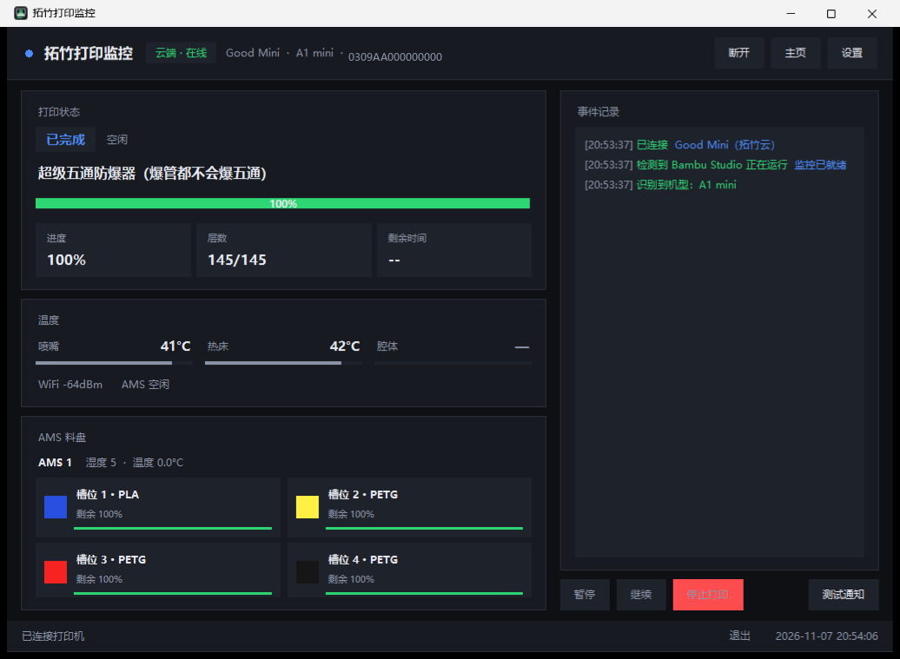
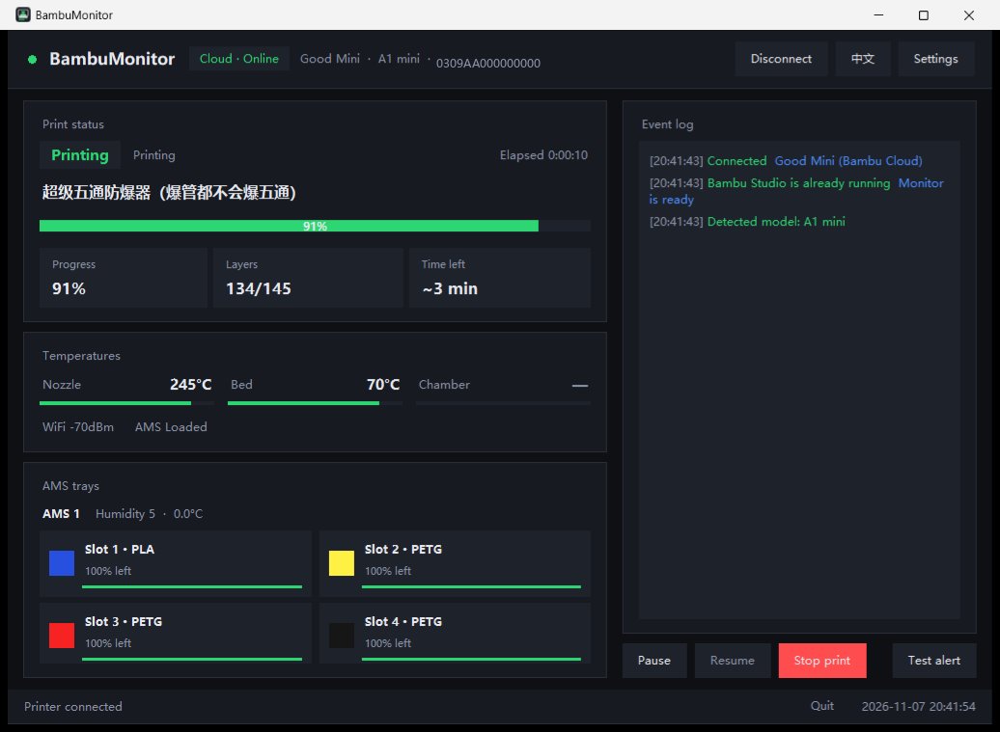

<div align="center">

# 🖨️ 拓竹打印监控 · BambuMonitor

**打印完成、换料暂停、机器报错 —— 让电脑主动喊你，而不是你守着它。**

一个给 [Bambu Lab](https://bambulab.com) 3D 打印机用的 Windows 桌面监控小工具。<br>
局域网直连、零配置发现、支持拓竹云中转（打印机和电脑不在同一个网络也能用）。

[](#)
[](#)
[](#-许可)
[](https://github.com/ou0826/bambu-monitor/releases)
[](https://github.com/ou0826/bambu-monitor/stargazers)

[English](README.en.md) · [下载发布版](https://github.com/ou0826/bambu-monitor/releases) · [快速开始](#-快速开始) · [常见问题](#-常见问题)

</div>



---

## ✨ 为什么需要它

拓竹的 Bambu Studio 是个好切片软件，但它**不会在打印完成时提醒你**；Bambu Handy 的通知只到手机。

这个工具补上那一环：**状态走本地或官方云，通知走 Windows 桌面**。

- 打印完成 → 弹窗 + 提示音，可以取件了
- 需要换料 / 断料 → 告诉你**具体原因**（不是一句"暂停了"）
- 机器报错 → HMS 编码 + 哪个模块 + 怎么排查
- 打印机失联 → 提醒你检查电源和网络

而且它**不打断工作**：通知进系统通知中心，重要事件再弹一个 20 秒后自动消失的置顶窗，点一下就回到面板。

---

## 🎯 功能一览

| | 能力 | 说明 |
|---|---|---|
| 📊 | **实时状态** | 进度、层数、剩余时间、已用时间、喷嘴 / 热床 / 腔体温度、WiFi 信号 |
| 🎨 | **AMS 料盘** | 每个槽位的颜色、材料、余量百分比与余量条 |
| 🔔 | **事件通知** | 完成 / 失败 / 暂停 / 换料 / 故障 / 失联，逐项可开关 |
| 🔊 | **三种提醒** | 系统通知（进通知中心）+ 置顶弹窗 + 自合成提示音 |
| 🏷️ | **自动识别机型** | A1 mini / A1 / P1P / P1S / P2S / X1 / X1 Carbon / X1E / H2D 系列 |
| 🪟 | **跟随 Bambu Studio** | 打开它时自动弹出并连接，关掉后可缩回托盘 |
| 🧭 | **系统托盘** | 关窗口收进托盘，右键菜单可打开面板 / 暂停 / 继续 / 退出 |
| 🌐 | **中英双语界面** | 设置里一键切换（切换后自动重启生效） |
| 🔀 | **双连接模式** | 局域网直连（最快）/ 拓竹云中转（跨网络） |
| 🎮 | **远程操作** | 面板上直接暂停 / 继续 / 停止（停止有二次确认） |
| 🔒 | **本地优先** | 局域网模式数据不出内网；云端只保存 token，不保存密码 |

---

## 📦 快速开始

### 1️⃣ 下载

到 [**Releases**](https://github.com/ou0826/bambu-monitor/releases) 下载 `BambuMonitor-v1.0.0.zip`，解压到任意目录（**不用装 Python**）。

> 也可以从源码运行，见 [从源码运行](#-从源码运行)。

### 2️⃣ 连接打印机

双击 `拓竹打印监控.exe` → 点右上角 **设置**：

- 点 **自动搜索打印机**（扫局域网，1~3 秒出结果），点一下结果即可自动填好 IP 和序列号
- 访问码没自动填的话，点 **从 Bambu Studio 导入访问码**，或手动输入
  （打印机屏幕：**设置 → 网络 → 访问码**，8 位）
- 点 **测试连接**，看到"连接成功"就 **保存**

### 3️⃣ 选择要提醒的事件

设置里勾选：开始打印 / 打印完成 / 打印失败 / 打印暂停 / 打印取消 / 换料提醒 / 故障告警 / 连接断开，以及提醒方式。

点 **试听/测试通知** 立刻验证。

想让它常驻：勾选 **开机自动启动** + **启动时最小化**。

> [!NOTE]
> **点右上角 X 只是缩到任务栏，程序不会退出**（还在后台盯着打印机）。
> 要彻底退出，点窗口右下角的 **「退出」**。

---

## 🔀 两种连接方式

| | 🏠 局域网直连 | ☁️ 拓竹云中转 |
|---|---|---|
| **适用** | 打印机和电脑在同一个网络 | 两者不在同一网络（如打印机连手机热点） |
| **前提** | 打印机的**访问码** | 电脑能上网 + 登录拓竹账号 |
| **延迟** | 最低（打印机每 2 秒直推） | 多一跳云端中转，监控够用 |
| **隐私** | 数据不出局域网 | 状态经拓竹官方服务器 |
| **摄像头** | 可直连 | 不支持 |
| **推荐** | ⭐ 优先用这个 | 实在跨网络时再用 |

### 🏠 局域网直连的原理

拓竹打印机在局域网里自带一个 **MQTT over TLS** 服务（端口 `8883`，用户名固定 `bblp`，密码就是屏幕上的**访问码**）。Bambu Studio 的"局域网模式"用的正是它。

本程序做的只是：

```
TLS 连接 ip:8883  →  订阅 device/<序列号>/report  →  解析状态  →  发通知
```

不劫持 Bambu Studio、不装驱动、不需要账号。

### ☁️ 云端模式怎么开

打印机不在同一网络时，程序会在连接失败后**自动弹出登录窗**（也可在 设置 → 跨网络（云端）→ 登录 / 更换账号）：

1. 填拓竹账号（手机号或邮箱）→ 点 **发送短信/邮件验证码**
2. 把收到的 6 位数字填进"验证码"→ 点 **登录**
3. 登录成功后自动选中你账号下已绑定的打印机，改走拓竹云

> [!TIP]
> 拓竹官方**没有扫码登录接口**，所以这里用验证码登录——不用记密码，密码也不会存到本地，登录后只保存一个 access token。

---

## 🔔 会提醒什么

| 事件 | 触发条件 | 提醒内容 |
|---|---|---|
| ✅ **打印完成** | 状态变为 `FINISH` | 文件名，提示可以取件 |
| ❌ **打印失败** | 状态变为 `FAILED`，或上报错误码 | 建议查看打印机屏幕 |
| ⏸️ **打印暂停** | 状态变为 `PAUSE` | **具体原因 + 处理建议**（断料、堵头、喷嘴温度异常、丢步、AMS 掉线、切刀异常…） |
| 🎨 **换料** | AMS 进入换料流程 | 当前子步骤（加热喷嘴 / 切旧料 / 送新料 / 冲刷） |
| ⚠️ **故障告警** | HMS 出现新条目 | HMS 编码 + 所属模块 + 排查建议 |
| 📡 **打印机失联** | 断连超过 120 秒 | 提醒检查电源 / WiFi |
| ▶️ 开始打印 / 取消 | 状态切换 | 可选，默认关闭 |

**这些细节都处理过了：**

- 🚫 **取消不算故障**：拓竹用 `print_error = 50348044` 表示"用户主动取消"，程序安静放过
- 🔁 **不重复轰炸**：同一完成事件、同一条 HMS、同一个换料步骤只提醒一次
- 😴 **不打扰旧任务**：开机时打印机停在"已完成"，不会补报
- 🔔 **需要人处理时会重复响铃**（可关闭），避免你错过

---

## 🖥️ 界面说明

```
┌─────────────────────────────────────────────────────────────────────┐
│ ● 拓竹打印监控  [局域网·在线]  A1 mini · 192.168.1.50   [断开] [设置] │
├──────────────────────────────────┬──────────────────────────────────┤
│ 打印状态                         │ 事件记录                         │
│  [打印中]  第 26/94 层           │  16:01 打印完成 🎉               │
│  参数优化，加快一点打印速度       │  15:44 正在换料                  │
│  ████████████░░░░░  69%          │  15:20 已连接                    │
│  ┌────────┬────────┬──────────┐  │                                  │
│  │ 进度   │ 层数   │ 剩余时间 │  │                                  │
│  │ 69%    │ 26/94  │ 22 分钟  │  │                                  │
│  └────────┴────────┴──────────┘  │                                  │
├──────────────────────────────────┤                                  │
│ 温度   喷嘴 245° / 热床 70° / 腔体 —│                                │
├──────────────────────────────────┤                                  │
│ AMS 料盘                         │                                  │
│ [■ 槽位1 PLA 剩100%] [■ 槽位2 …] │                                  │
├──────────────────────────────────┴──────────────────────────────────┤
│ [暂停] [继续] [停止打印]                        [测试通知]           │
├─────────────────────────────────────────────────────────────────────┤
│ 已连接打印机                            退出   2026-11-07 20:03:03   │
└─────────────────────────────────────────────────────────────────────┘
```

顶部胶囊会显示**连接方式 + 在线状态**（局域网/云端 · 在线/离线），旁边是**机型**和**打印机地址**。

**界面语言**：设置里可以切到 English，切完自动重启生效。英文界面长这样：

> 顶栏的「主页」按钮会打开项目主页（GitHub 仓库），主页首屏有 [English](README.en.md) 链接可切到英文说明。



---

## ❓ 常见问题

<details>
<summary><b>连不上打印机，提示「跨网段」</b></summary>

打印机和电脑不在同一个网络。两个办法：

1. 把打印机连到和电脑同一个 WiFi（打印机屏幕：设置 → 网络）
2. 在程序里登录拓竹账号，走云端（见 [两种连接方式](#-两种连接方式)）
</details>

<details>
<summary><b>收不到系统通知</b></summary>

- Windows「设置 → 系统 → 通知」里要打开通知，且不要开"专注助手"
- 程序第一次运行会注册一个叫「拓竹打印监控」的通知来源，被拦的话去通知设置里放行
- 用「测试通知」按钮验证最快
</details>

<details>
<summary><b>提示音没声音</b></summary>

检查系统音量和音量合成器里本程序的音量，并确认设置里「提示音」勾上了。
</details>

<details>
<summary><b>腔温显示「—」</b></summary>

A1 / A1 mini / P1 系列没有腔体温度传感器，固件会固定上报占位值，程序识别后显示为 `—`，不是故障。
</details>

<details>
<summary><b>机型识别错了</b></summary>

连上打印机后程序会自动问机型（读 `info.get_version` 里的 `project_name`）；识别不出来时可在 **设置 → 机型** 手动选一个。
</details>

<details>
<summary><b>云端登录提示「这个账号需要用验证码登录」</b></summary>

正常。按提示点「发送短信验证码」或「发送邮件验证码」，把收到的数字填进验证码框即可。
服务器不支持密码登录的账号，只能用验证码。
</details>

<details>
<summary><b>云端登录报「账号或密码不正确」，但密码没错</b></summary>

拓竹账号分**中国区**和**国际区**，两个区的接口不同。程序会按区域自动尝试，两边都失败时建议直接用验证码登录（不需要密码）。
</details>

<details>
<summary><b>能监控多台打印机吗</b></summary>

当前版本一次一台。换机器在设置里改 IP / 序列号，或重新登录选择设备。
</details>

---

## 🔒 隐私与安全

| 项目 | 说明 |
|---|---|
| 局域网模式 | 数据**不出局域网**，不联网 |
| 云端模式 | 状态经**拓竹官方服务器**中转，无第三方 |
| 登录凭证 | 只保存 access token，**不保存密码** |
| 配置文件 | `%APPDATA%\BambuMonitor\config.json`（含访问码 / token，明文，与 Bambu Studio 做法一致） |
| 分享注意 | ⚠️ **不要把 `config.json` 一起发给别人**——里面有你的访问码和登录凭证 |

程序不会上传任何数据到第三方服务，也不收集使用统计。

---

## 🧑‍💻 从源码运行

需要 Windows 10/11 + Python 3.10+。

```bash
pip install -r requirements.txt
python main.py                 # 正常运行
python main.py --minimized     # 最小化启动（开机自启用的就是它）
python main.py --demo          # 演示四种提醒（不连打印机也能看效果）
python main.py --test-notify   # 只发一条测试通知
python main.py --diagnose      # 进程检测诊断
```

打包成 exe：

```bash
build_exe.bat          # 文件夹版（推荐，产物在 dist\拓竹打印监控\）
build_exe_onefile.bat  # 单文件版（个别机器临时目录受限时会失败）
```

跑测试：

```bash
python tests\test_watcher.py       # 状态判定（10 组）
python tests\test_models.py        # 机型识别
python tests\test_login_flow.py    # 云端登录窗口流程
python tests\replay_capture.py tests\fixtures\sample_capture.jsonl   # 真实报文回放
```

---

## 📁 项目结构

```
BambuMonitor/
├── main.py                  入口（单实例锁、命令行参数、日志）
├── bambu_monitor/
│   ├── config.py            配置读写（%APPDATA%，不可写时自动降级到程序目录）
│   ├── discovery.py         局域网发现（扫 8883 + 读证书取序列号 + 读 Bambu Studio 访问码）
│   ├── mqtt_client.py       MQTT over TLS（局域网 / 云端）、pushall、暂停/继续/停止
│   ├── cloud.py             拓竹云账号：登录、验证码、设备列表、云 MQTT 参数
│   ├── state.py             增量合并 + 事件判定（状态机、阶段表、HMS 解析）
│   ├── models.py            机型识别（代号 → 名称）
│   ├── procwatch.py         进程跟随（监视 bambu-studio.exe）
│   ├── notify.py            WinRT 通知 + 提示音合成与播放
│   ├── ui.py                界面、置顶弹窗、设置、云端登录窗
│   └── autostart.py         开机自启
├── tools/启动拓竹并监控.bat  一键「先开监控再开 Bambu Studio」
├── tests/                   单元测试 + 真实抓包样本
└── assets/app.ico           图标
```

### 技术要点

- **发现**：扫描局域网 `8883`，用 TLS 握手读证书 CN 拿到序列号（拓竹自签证书的 CN 就是 SN）
- **状态**：订阅 `device/<SN>/report`；P1 / A1 系列只上报变化字段，程序做了增量合并
- **判定**：`gcode_state` / `stg_cur`（78 个阶段中文化）/ `print_error` / `hms` / `ams_status`
- **通知**：通过 PowerShell 调 WinRT `ToastNotificationManager`，注册 AppUserModelID；提示音用 `winsound` 播放程序合成的 WAV
- **云端**：官方接口 `api.bambulab.cn` / `api.bambulab.com`（按区域自动选择），云 MQTT `cn.mqtt.bambulab.com:8883`，用户名 `u_<uid>`、密码 `accessToken`

---

## ⚠️ 说明

本项目是**非官方**工具，与拓竹科技无关。只读打印机上报的状态，控制指令（暂停 / 继续 / 停止）是官方协议支持的标准命令，请自行确认使用风险。

---

## 📄 许可

[MIT](LICENSE) © 2026 BambuMonitor contributors

<div align="center">

**如果这个工具帮你少守了几次机器，点个 ⭐ 吧**

</div>
